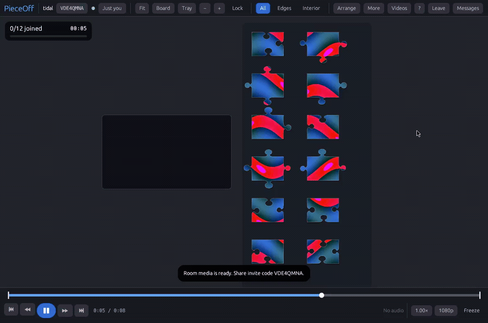

<div align="center">

# PieceOff

### A video-first jigsaw puzzle you can solve together.

Turn a looping video, animated image, or photo into a shared puzzle. Invite
friends, move pieces together, and watch the same moment unfold across every
piece.

[](https://github.com/UnsupervisedMedia/PieceOffApp/actions/workflows/ci.yml)
[](LICENSE)
[](https://www.rust-lang.org/)

[See the gameplay](#gameplay) · [Get started](#play-locally) · [Self-host a room](#host-a-room) · [Contribute](#contributing)

</div>

## Gameplay

This is an actual capture of PieceOff running a local video puzzle: watch two
adjacent pieces move from the tray and snap together on the board while the
video keeps playing across them. The procedural test video is original and
the recording is silent.

[](docs/media/pieceoff-gameplay.mp4)

[Watch or download the full MP4](docs/media/pieceoff-gameplay.mp4).

## What you can do

- **Solve video puzzles together.** Everyone sees the same room state and
  follows shared play, pause, seek, loop, and playback-speed controls.
- **Bring your own media.** Use still images, animated images, or video. Guests
  can download the room media or use a matching local copy.
- **Start with built-in art.** Pick from eight original animated loops,
  included with the app and ready to puzzle. See the
  [media guide](docs/BUILTIN_MEDIA.md) for their source and license.
- **Work naturally with pieces.** Drag, snap, join, multi-select, and move
  linked groups. Pan and zoom around a shared board and a loose-piece tray.
- **Pick a cut.** Classic jigsaw pieces, hexagons, or triangles, previewed
  on the picture before you create the room.
- **Talk while you puzzle.** Room chat in the corner of the board, and a
  key that pings a spot on the table for everyone to see. Short synthesised
  sounds mark snaps, joins, the finish, chat, and pings, with their own
  volume under More.
- **Sort in your own space.** Make up to four piece holders on the open
  table: anything you put in yours stays yours, visible to everyone but
  only movable by you, and moves with the holder.
- **Race the clock.** A shared solve timer runs while anyone is in the room,
  and the finish card shows who placed how many pieces. The library keeps
  each puzzle's best time.
- **Watch, then replay.** Tick **Watch only** to join a room as a spectator
  who sees everything and chats but moves nothing. **Timelapse** on the
  finish card (or **More → Watch timelapse**) replays the solve from the
  scattered start in 20–60 seconds, on your screen only.
- **Keep your progress.** Rooms save on the server. Rejoin after disconnects,
  or export a self-contained `.pieceoff` package with puzzle progress and media.
- **Run your own rooms.** The desktop app and server are open source. Host
  locally, on a private network, or behind an HTTPS reverse proxy.
- **Play image puzzles too.** Still-image puzzles use the same puzzle model and
  room system as video puzzles.

PieceOff is a playable prototype under active development. Linux development
and release builds are available. Windows builds are cross-checked in CI, but
native Windows and macOS launch checks and a two-person video/audio playtest
remain release-readiness work. See the [feature matrix](docs/FEATURE_MATRIX.md)
for implemented and remaining work.

## Play locally

### Install

On Linux or macOS, install the latest published release with:

```sh
./install.sh
```

Choose **release** to download the matching release bundle, or **local** to
build from this checkout. The choice can be supplied directly with
`./install.sh --release` or `./install.sh --local`; add `--yes` for scripts
that should not prompt. By default the install goes under
`~/.local/opt/PieceOff` and adds a `pieceoff` command in `~/.local/bin`.
Running `pieceoff` starts both the room server and desktop app; pass `stop`,
`restart`, or `status` to manage them. Use `--prefix DIR` and `--bin-dir DIR`
to change the install locations. On Windows, download the Windows release zip
and use its `pieceoff.ps1` launcher.

### Requirements

- Rust 1.87 or newer and Cargo
- On Linux, ALSA development headers to build audio output (for Debian or
  Ubuntu: `libasound2-dev`)
- FFmpeg and `ffprobe` for video and animated APNG/GIF media. Animated WebP and
  still images use the native Rust decoder.

### Start the app and room server

From a checkout, the launcher builds what changed, starts a local room server,
and opens the desktop app:

```sh
./play.sh
```

To open a media file immediately, pass its path. Add `--two` to start a second
client for trying multiplayer on one machine:

```sh
./play.sh path/to/video.mp4
./play.sh --two path/to/video.mp4
```

You can also run the binaries directly in two terminals:

```sh
cargo run -p pieceoff-server
```

```sh
cargo run -p pieceoff-app
```

Choose an image, video, animated image, or `.pieceoff` package on the start
screen. Create a room and share its invite code. A friend can enter the room
server address and code to join; the server address defaults to
`ws://<host>:28878/ws` for a room on another machine.

### Supported media and limits

Still images and animated WebP use the native Rust image decoder. Video and
animated APNG/GIF use FFmpeg. Common video formats include MP4, MOV, MKV,
WebM, AVI, MPEG, OGV, FLV, 3GP, WMV, TS, MTS, and M2TS.

FFmpeg is an external tool and is not included in the default release bundles.
Install `ffmpeg` and `ffprobe`, place them beside the app, or select their
location under **Media tools**. See [FFmpeg distribution notes](docs/FFMPEG.md)
before changing bundle behavior.

The server accepts files up to 16 GiB by default, with a 50 GiB aggregate media
quota. Both limits are configurable. Downloads resume after interruption.
Video puzzles can use the whole clip or a selected loop segment. The host
controls shared playback; volume, mute, audio delay, quality, and freeze-frame
assist are local to each device.

## Host a room

The room server listens on `0.0.0.0:28878` by default. To bind to a specific
address or choose another port:

```sh
PIECEOFF_BIND=127.0.0.1:28878 cargo run -p pieceoff-server
```

For remote play, put the server behind an HTTPS reverse proxy that supports
WebSocket upgrades, then enter its `wss://` URL in the app. The server does not
terminate TLS itself. A production Caddy setup, Docker deployment, storage
limits, room retention, and security settings are covered in the
[deployment guide](docs/DEPLOYMENT.md).

Room snapshots and uploaded media live in `pieceoff-data/` by default. Set
`PIECEOFF_DATA_DIR` to move them. Rooms have invite codes and no accounts, so
share codes only with the people you want in the room.

## Controls at a glance

| Action | Control |
| --- | --- |
| Fit board, focus board, focus tray | **F**, **B**, **T** |
| Zoom | **− / +** or mouse wheel |
| Multi-select pieces | **Ctrl-click** (or **Command-click** on macOS) |
| Pan | Drag empty space, **Shift-drag**, or middle/right mouse button |
| Reset view | Double-click empty space |
| Video play/pause | **Space** |
| Video seek | **← / →** by five seconds; **Home / End** for loop edges |
| Help and messages | **F1 / ?** and **M** |
| Chat, ping the spot under the pointer | **Enter**, **P** |
| New piece holder near the pointer | **H** |

Shortcuts can be rebound in **More → Controls…**. The board also has **All**,
**Edges**, and **Interior** tray filters, **Arrange** for loose pieces, and
**Holders** to make, rename, and remove holders.
Press **F1** or **?** in the app for the complete shortcut list.

## Build and develop

```sh
cargo build --workspace
cargo run -p pieceoff-app
```

The workspace contains three crates:

- `pieceoff-core` — puzzle rules, piece topology, room messages, serialization
- `pieceoff-server` — authoritative room state, validation, and persistence
- `pieceoff-app` — desktop UI, rendering, input, and media integration

Media decoding stays behind `MediaDecoderBackend`; core puzzle rules do not
depend on a codec implementation. For architecture, packaging, and the
multiplayer test workflow, see [Architecture](docs/ARCHITECTURE.md),
[Packaging](docs/PACKAGING.md), and [Testing](docs/TESTING.md).

Useful development options:

- `./play.sh --silent` runs without audio.
- `PIECEOFF_MEDIA=/path/to/file` preloads media; a media path can also be passed
  to `./play.sh`.
- `PIECEOFF_NO_AUDIO=1` disables audio output.
- `scripts/visual-dev.sh` runs the app on a virtual display for visual
  inspection.

Successful GitHub Actions runs attach short-lived Linux, Windows, and macOS
test bundles. Download them from the run's **Artifacts** section in
[Actions](https://github.com/UnsupervisedMedia/PieceOffApp/actions). These are CI test
bundles, not stable versioned releases.

## Project guides

| Guide | What it covers |
| --- | --- |
| [Build plan](docs/PLAN.md) | Product direction, milestones, and release gates |
| [Feature matrix](docs/FEATURE_MATRIX.md) | Current implementation and remaining parity work |
| [Architecture](docs/ARCHITECTURE.md) | Crate boundaries, media, networking, and package model |
| [Deployment](docs/DEPLOYMENT.md) | Hosting the room server |
| [Packaging](docs/PACKAGING.md) | Native builds and test bundles |
| [Testing](docs/TESTING.md) | Multiplayer, persistence, media, and playtest coverage |
| [Built-in media](docs/BUILTIN_MEDIA.md) | Procedural art recipe and asset licensing |
| [Licensing](docs/LICENSING.md) | Project license, third-party notices, and hosted-service model |

## Contributing

Issues and pull requests are welcome. Please read the
[contributor guide](CONTRIBUTING.md) before opening a pull request. Keep
changes focused, document protocol or package compatibility changes, and
include the result of `scripts/check.sh` in your pull request description.

Contributions are welcome under Apache-2.0. Contributors retain copyright;
there is no required DCO sign-off, CLA, or copyright assignment. See the
[contribution licensing terms](docs/LICENSING.md#open-source-and-hosted-service-model).

## License

PieceOff's original source and documentation are licensed under the
[Apache License 2.0](LICENSE). Third-party dependencies and bundled fonts or
media keep their own licenses; see [licensing and notices](docs/LICENSING.md).
The optional hosted service at [pieceoff.app](https://pieceoff.app), if
offered, is separate from the software license. Anyone may use and self-host
the open-source app and server under Apache-2.0.
